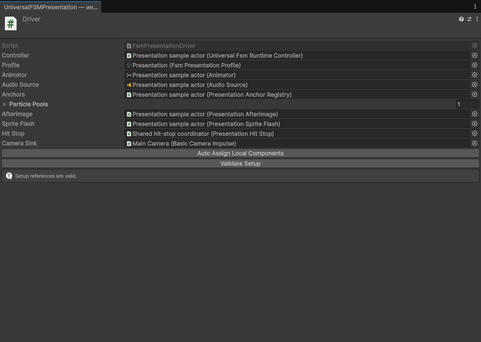

# Ассеты и компоненты

Все типы исполнения находятся в пространстве имён `OblivioMentis.Presentation`. Настройте сериализуемые поля до включения и привязки. После изменения профиля, настроек эффектов, экземпляра FSM или Animator Controller выполните привязку заново. Вызовы допускаются только из главного потока Unity.

## Профиль и привязки

`FsmPresentationProfile` — переиспользуемый ScriptableObject, создаваемый через **Assets > Create > FSM > Presentation > Profile**.

| Поле | Назначение |
|---|---|
| `definition` | Определение UniversalFSM, чьи идентификаторы состояний используются в привязках. Автоматическая привязка требует ту же ссылку, что и `controller.RuntimeDefinitionAsset`. При ручной привязке это проверяет вызывающий код. |
| `bindings` | Упорядоченный массив `PresentationBinding`. Все записи с одинаковым точным ключом выполняются в заданном порядке. |

Каждая привязка содержит:

| Поле | Назначение |
|---|---|
| `trigger` | `StateEnter` — вход, значение по умолчанию; `StateExit` — выход; `Transition` — переход; `DomainEvent` — доменное событие. |
| `layerId` | Стабильный хеш ключа слоя FSM для состояний и переходов. Используйте выбор слоя в инспекторе вместо ручного ввода хеша. |
| `stateId` | Точный идентификатор состояния; у перехода — исходного. |
| `toStateId` | Идентификатор назначения для Transition; игнорируется другими видами привязки. |
| `eventKey` | Непустой регистрозависимый ключ DomainEvent. Для состояний игнорируется; доменное сопоставление не учитывает поля слоя и состояния. |
| `actions` | Упорядоченные ссылки на ассеты эффектов. Отсутствующие ссылки недопустимы. Повторяющаяся ссылка выполняется столько раз, сколько она указана. |

Зеркальные состояния разрешаются в идентификатор исходного состояния, сохраняя свой слой FSM. Имена служат для настройки; исполнение сопоставляет идентификаторы. Шаблонов и подстановочных селекторов нет.

## FsmPresentationDriver

Добавляется через **Add Component > FSM > Presentation > Driver**. Один драйвер координирует эффекты персонажа.

| Поле | Что назначить |
|---|---|
| `controller` | Инициализированный `UniversalFsmRuntimeController` для автоматического наблюдения. Оставьте null, если привязкой полностью управляет ваш код. |
| `profile` | Настроенный профиль. Требуется при привязке. |
| `animator` | Animator с контроллером для эффектов состояний и триггеров. |
| `audioSource` | Отдельный AudioSource: очистка останавливает все его однократные звуки. Отключите Play On Awake. |
| `anchors` | `PresentationAnchorRegistry` персонажа для оружия, других объектов и именованных точек появления частиц. |
| `particlePools` | Пулы, соответствующие префабам ParticleCue. Массив позволяет подключить несколько разных префабов. |
| `afterimage` | Отдельный `PresentationAfterimage` персонажа. |
| `spriteFlash` | Отдельный `PresentationSpriteFlash` персонажа. |
| `hitStop` | Один общий координатор сцены для всех участвующих персонажей. |
| `cameraSink` | MonoBehaviour с интерфейсом `IUniversalFsmCameraImpulseSink`; нужен при использовании эффекта камеры. |

**Auto Assign Local Components** сохраняет существующие ссылки, заполняет компоненты с того же GameObject и добавляет его пулы без повторов. Для Animator подходит компонент того же объекта или единственный однозначный дочерний Animator. Поиск по всей сцене и выбор общего координатора времени или камеры не выполняются.

**Validate Setup** проверяет согласованность контроллера и профиля, отсутствующие эффекты и компоненты, ключи событий, наличие пулов и поддерживаемую структуру префабов. **Add Pool: имя префаба** добавляет или повторно использует подходящий пул, записывает Undo и обновляет список драйвера. Проверка не создаёт частицы и не заменяет запуск каждого настроенного эффекта.

*В примере назначены контроллер, профиль, компоненты отклика, пул частиц и явные ссылки на общий координатор времени и адаптер камеры.*

## PresentationAnchorRegistry

Реестр сцены нужен потому, что переиспользуемый ассет эффекта не может напрямую ссылаться на конкретного персонажа сцены.

| Поле | Назначение |
|---|---|
| `entries` | Массив именованных ссылок на объекты сцены. |
| `Entry.key` | Точное уникальное имя, например `weapon`, `feet` или `muzzle`. |
| `Entry.target` | Transform точки появления частиц или объекта, чья активность переключается. |
| `Entry.renderers` | Группа Renderer для переключения только отрисовки. |

`Resolve(key)` выдаёт исключение, если ключ отсутствует или повторяется. Персонажи, использующие один эффект, должны согласовать имена точек. Переключение всего GameObject также затрагивает его скрипты; используйте Renderers Only, если игровые компоненты должны оставаться активными.

## PresentationParticlePool

Пул фиксированной вместимости для одного префаба ParticleSystem, видимый в сцене.

| Поле инспектора | Назначение |
|---|---|
| Prefab (`_prefab`) | Префаб ровно с одним незацикленным ParticleSystem, включая неактивных потомков; вложенные эмиттеры запрещены. |
| Capacity (`_capacity`) | Число заранее создаваемых экземпляров: по умолчанию 8, минимум 1. Задаётся до инициализации. |

Awake инициализирует настроенный пул. При программной настройке вызовите `Initialize(prefab, capacity)` до отправки событий. После инициализации изменить префаб или вместимость нельзя. Для наблюдения доступны `Prefab`, `Capacity` — выделенное число экземпляров — и `ActiveCount`.

Экземпляры размещаются под созданным корневым объектом в сцене пула, используют мировую позицию появления и возвращаются по событию остановки ParticleSystem. При заполнении пула новый запрос отбрасывается, а `TryPlay` возвращает false. Во время игры пул не растёт. `Clear(driver)` очищает экземпляры только указанного владельца; отключение пула освобождает все слоты. Частицы, принадлежащие состоянию, останавливаются перед его эффектами выхода. Остальные возвращаются после естественного завершения.

## PresentationAfterimage

| Поле инспектора | Назначение |
|---|---|
| Source | SpriteRenderer для снимка; ему должен быть назначен спрайт. |
| Capacity (`_capacity`) | Число заранее созданных силуэтов: по умолчанию 12, минимум 1. |

`Snapshot(tint, duration)` копирует спрайт, материал, сортировку, отражение, режим рисования, размер и мировой Transform в свободный слот. Прозрачность уменьшается по немасштабированному времени. При заполнении пула возвращается false. Силуэты не следуют за персонажем. `ActiveCount` показывает занятость; `Clear()` освобождает все снимки. Ассет эффекта можно разделять, но компонент нужен отдельный для каждого персонажа.

## PresentationSpriteFlash

Поле **Renderers** содержит массив SpriteRenderer. `Flash(color, duration)` запоминает исходные цвета при первом активном запросе. Повторные запросы заменяют цвет и продлевают время завершения. Используется немасштабированное время.

`Clear()` восстанавливает цвет, только если Renderer всё ещё имеет последнее значение, записанное вспышкой. Так сохраняются более поздние изменения других систем. Нельзя менять массив Renderer во время активной вспышки. Этот компонент меняет оттенок, а не реализует эффект материала или шейдера.

## PresentationHitStop

Разместите в сцене один координатор и назначьте его всем драйверам с HitStopCue. **Scale Fixed Delta Time** дополнительно масштабирует шаг физики вместе со временем; по умолчанию выключен.

`RequestStop(owner, scale, duration)` принимает активный драйвер, конечный масштаб из [0,1] и положительную конечную длительность в немасштабированных секундах. Одновременные запросы используют минимум между сохранённым исходным масштабом и всеми запрошенными значениями. `ActiveCount` показывает число запросов; `Cancel(owner)` удаляет запросы владельца.

Координатор запоминает исходное состояние времени при первом запросе и восстанавливает значения, только пока сохраняет право ими управлять. Запись времени другой системой прекращает это владение. Перед тем как контроллер паузы изменит `Time.timeScale`, вызовите `SetPaused(true)`: это также обрабатывает повторную запись нуля, которую нельзя обнаружить сравнением значений. Вызовите `SetPaused(false)` после того, как система паузы восстановит собственное состояние времени. При паузе новые запросы игнорируются.

## Адаптер камеры

`IUniversalFsmCameraImpulseSink.EmitImpulse(float amplitude, float durationSeconds)` — граница подключения камеры. Сам пакет не содержит и не требует готовую систему камеры. [BasicCameraImpulse](../Samples~/BasicPresentation/BasicCameraImpulse.cs) реализует для примера короткое боковое колебание по немасштабированному времени. Игровая система камеры должна сама объединять свои смещения.

## Ассеты эффектов

Все девять встроенных типов и пользовательские расширения наследуют `PresentationCue`. Они содержат переиспользуемые настройки; изменяемое состояние конкретного персонажа хранится в компонентах сцены. Все встроенные поля описаны в [справочнике эффектов](CueReference.md), правила расширения и очистки — в [руководстве по собственным эффектам](CustomCues.md).

[Оглавление](index.md)

