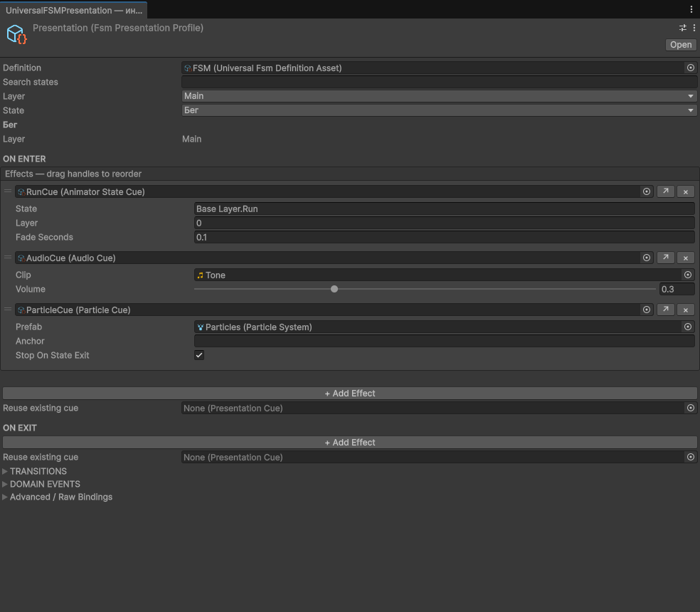
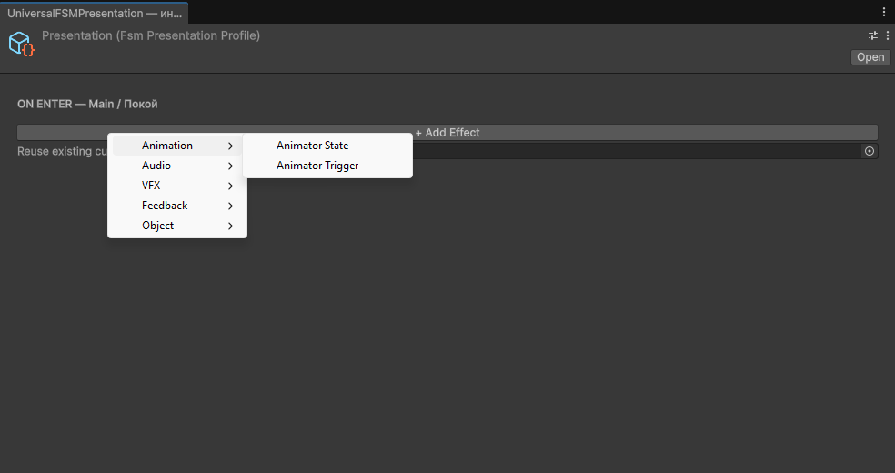
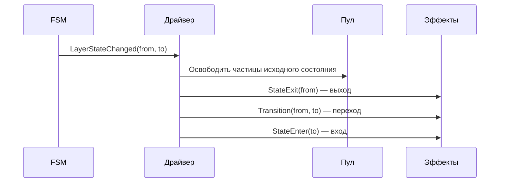

# Порядок настройки и исполнения

## Инспектор профиля и рабочая область FSM

Создайте **Assets > Create > FSM > Presentation > Profile** в папке `Assets`, затем назначьте определение FSM. Профиль редактируется в инспекторе Project или в рабочей области Presentation редактора UniversalFSM. В обоих случаях используется один и тот же инспектор. Рабочая область передаёт определение, но выбор состояния у Presentation собственный.

1. **Search states** фильтрует отображаемые имена без учёта регистра.
2. **Layer** выбирает слой FSM.
3. **State** выбирает состояние из отфильтрованного списка. Для зеркал показывается подсказка об исходном идентификаторе.
4. **ON ENTER / ON EXIT** показывают точные привязки входа и выхода для выбранных состояния и слоя.
5. **+ Add Effect** предлагает девять встроенных типов. Команда создаёт ассет рядом с профилем в папке `<ProfileName> Cues`, добавляет ссылку и поддерживает Undo.
6. Редактируйте поля прямо в списке и перетаскивайте ручки строк для изменения порядка. Кнопка поиска ассета выделяет его в Project. Удаление ссылки сохраняет ассет. Для переиспользования перетащите существующий эффект из Project.
7. **TRANSITIONS** добавляет точную пару исходного и целевого состояния внутри слоя. Такая привязка выполняется, только если оба состояния допустимы.
8. **DOMAIN EVENTS** добавляет точный ключ, например `Damage` или `Impact.Accepted`. Сопоставление учитывает регистр и не зависит от состояния FSM.
9. **Advanced / Raw Bindings** раскрывает исходный массив и числовые идентификаторы. Это те же привязки, а не дополнительная конфигурация.

Несколько одинаковых точных привязок допустимы: их списки действий исполняются по порядку массива. Изменение общего ассета эффекта влияет на все ссылки. Создайте отдельный ассет, если персонажу или состоянию нужны другие параметры. Сохраняйте ассеты до Play Mode; изменение конфигурации во время исполнения не является поддерживаемым режимом редактирования.



*При входе в бег выполняются Animator, Audio и Particle в заданном порядке. Stop On State Exit связывает время жизни частиц с состоянием.*



*Меню объединяет эффекты по категориям Animation, Audio, VFX, Feedback и Object. В Animation доступны Animator State и Animator Trigger. Выбор создаёт отдельный ассет и добавляет его ссылку в привязку.*

## Что и когда исполняется



Внутри категории подходящие привязки и действия исполняются синхронно в заданном порядке. Планировщика задержек, параллельного исполнения или цепочек завершения нет. Доменное событие независимо запускает привязку своего точного ключа.

При привязке драйвер разрешает зеркальные идентификаторы в исходные. Состояния сопоставляются по хешу слоя и ID, переходы дополнительно учитывают назначение. Доменные события игнорируют селекторы слоя и состояния. Отсутствующая ссылка на эффект или неверное значение перечисления отклоняются при привязке.

Если пользовательский эффект сбрасывает, отвязывает или отключает драйвер, проверка версии исполнения прекращает оставшуюся часть рассылки. Исключения пользовательских Execute и Stop записываются и изолируются. Ошибки настройки встроенных эффектов остаются видимыми и могут прервать текущую рассылку; предупреждения проверки нужно исправлять.

## Автоматическая привязка контроллера

Включённый драйвер с назначенным `controller` выполняет привязку в Start после Awake контроллера. Проверяется соответствие определения профиля определению созданной FSM. Если источник реализует `IUniversalFsmCurrentLayerStateSource`, привязка один раз повторяет эффекты входа каждого текущего состояния. Это поддерживает позднее подключение, но означает, что повторная привязка может повторить звуки и другие эффекты.

После первого Start повторное включение такого драйвера автоматически восстанавливает наблюдение за состояниями. Эта привязка не подключает пользовательскую шину доменных событий.

## Ручная привязка и доменные события

Для собственной FSM или явной шины событий сначала инициализируйте источник и назначьте профиль со всеми компонентами. Включите драйвер и вызовите:

```csharp
driver.Bind(stateChangeSource, domainBus);
```

Оба параметра — интерфейсы UniversalFSM: источник реализует `IUniversalFsmStateChangeSource`, необязательная шина — `IUniversalFsmSignalBus`. Вызывающий код гарантирует соответствие определения профиля источнику. Если привязкой полностью управляет ваш код, оставьте `driver.controller` равным null, чтобы автоматическое включение не заменяло подписку и не повторяло эффекты входа дважды.

Bind всегда отменяет прежние подписки и очищает эффекты перед построением новой карты. Не вызывайте его каждый Update или FixedUpdate. Выполните один вызов после инициализации, затем повторяйте после замены FSM, изменения конфигурации или повторного включения вручную управляемого драйвера. Пример сохраняет ссылку на контроллер в режиме редактирования для проверки, а в Start очищает автоматическое поле драйвера и сам подключает источник с шиной.

```csharp
var bus = new UniversalFsmSignalBus();
driver.Bind((IUniversalFsmStateChangeSource)controller.Runtime, bus);
bus.Publish(UniversalFsmSignal.Domain("Damage",
    domainPayload: new UniversalFsmDomainPayload(duration: 0.06f)));
```

Фрагмент требует `using OblivioMentis.UniversalFSM;` и уже инициализированного контроллера. Полная запускаемая реализация — [BasicPresentationDemo](../Samples~/BasicPresentation/BasicPresentationDemo.cs).

## Сброс, отвязка и отключение

`ResetPresentation()` сохраняет подписки, но очищает временные эффекты:

- Один раз вызывает Stop для каждого уникального выполненного ассета, изолируя исключения.
- Останавливает выделенный AudioSource.
- Освобождает частицы этого драйвера в назначенных пулах.
- Очищает силуэты и вспышку спрайта.
- Отменяет запросы остановки времени этого драйвера.

При полном сбросе персонажа очистите эффекты **до** сброса FSM:

```csharp
driver.ResetPresentation();
controller.ResetRuntime();
```

После этого сброс FSM может сообщить об изменении состояний и применить новые привязки. Сброс только FSM не гарантирует удаления независимых доменных эффектов.

`Unbind()` отписывается от источника и шины, затем выполняет ту же очистку. Отключение драйвера вызывает Unbind. Ручную привязку после повторного включения восстанавливайте явно.

Состояние и параметры Animator, а также переключение объектов — постоянные изменения, а не временные ресурсы. Общая очистка их не восстанавливает. Задайте эффекты выхода и начального состояния либо обработайте это в сбросе игрового кода. Адаптеры камеры также сами управляют временем жизни своих эффектов.

## Пулы и владение ресурсами

Подготовьте пулы до отправки событий. ParticleCue требует точного совпадения префаба в списке драйвера; кнопка **Add Pool** помогает создать эту связь. Вместимость выбирайте по максимальному числу одновременных эффектов и отдельно проверяйте её исчерпание. Заполненные пулы отбрасывают новые запросы. Поддерживается один незацикленный ParticleSystem без вложенных эмиттеров.

AudioSource, компоненты силуэтов и вспышки должны быть отдельными для каждого драйвера. Пул частиц может обслуживать нескольких владельцев и учитывает принадлежность экземпляров. Глобальное время координирует один общий PresentationHitStop; вызывайте его обработчик паузы до того, как владелец паузы запишет масштаб времени. Все правила очистки и времени жизни приведены в [справочнике компонентов](AssetsAndComponents.md).

[Оглавление](index.md)

