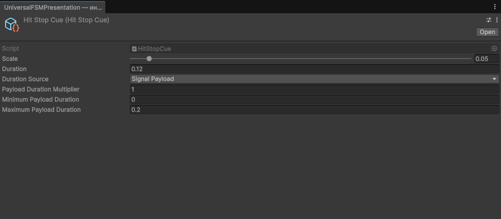

# Справочник эффектов

Создавайте встроенные эффекты через **+ Add Effect** в профиле. Каждый эффект — отдельный ScriptableObject в упорядоченном списке действий привязки. Разделы ON ENTER, ON EXIT, TRANSITIONS и DOMAIN EVENTS задают момент исполнения. Перед привязкой настройте соответствующие [компоненты драйвера](AssetsAndComponents.md).

## Состояние Animator — Animation / Animator State

Выполняет плавный переход к полному пути состояния через `Animator.CrossFadeInFixedTime`.

| Поле | По умолчанию | Назначение |
|---|---|---|
| State | `Base Layer.Idle` | Полный путь, включая путь вложенного автомата Animator. |
| Layer | 0 | Индекс слоя Animator: неотрицательный и меньше числа слоёв. |
| Fade Seconds | 0,1 | Конечная неотрицательная длительность перехода в секундах, не в нормализованном времени. |

Требуются назначенный Animator, его контроллер и существующее состояние на выбранном слое. Неверная конфигурация вызывает исключение. Для входа в бег задайте `Base Layer.Run`, слой 0 и переход 0,08 секунды. Имена состояний FSM и Animator могут различаться: их связывают привязка и заданный путь.

Эффект не сообщает FSM о завершении анимации. Для этого используйте игровое время или обработчик AnimationEvent.

## Триггер Animator — Animation / Animator Trigger

Устанавливает или сбрасывает объявленный параметр Animator типа Trigger.

| Поле | По умолчанию | Назначение |
|---|---|---|
| Parameter | пусто | Точное непустое имя параметра-триггера. |
| Reset | false | false вызывает SetTrigger, true — ResetTrigger. |

Контроллер Animator должен содержать параметр именно типа Trigger с таким именем. Bool, Int или Float не подходят. Например, установите `Attack` при входе в атаку и сбросьте при выходе, если это требуется графу Animator. Общая очистка эффектов сама не сбрасывает параметры Animator.

## Звук — Audio / Audio One Shot

Воспроизводит однократный звук через отдельный AudioSource драйвера. Несколько звуков могут звучать одновременно.

| Поле | По умолчанию | Назначение |
|---|---|---|
| Clip | null | Воспроизводимый AudioClip. |
| Volume | 1 | Конечный множитель громкости из [0,1]. |

Требуются Clip и AudioSource. Добавьте звук атаки с громкостью 0,35 при входе в состояние или звук попадания в событие подтверждённого удара. Повторные эффекты могут перекрываться. Reset и Unbind останавливают все однократные звуки выделенного источника. Индивидуальная отмена голосов, расписание изменения высоты тона и отдельный пул голосов относятся к пользовательским адаптерам.

## Частицы — VFX / Particle One Shot

Запрашивает частицы из первого пула драйвера с совпадающим префабом.

| Поле | По умолчанию | Назначение |
|---|---|---|
| Prefab | null | Тот же префаб, что назначен заранее подготовленному PresentationParticlePool. |
| Anchor | пусто | Пустое значение использует Transform драйвера; иначе выбирается именованная точка реестра. |
| Stop On State Exit | false | Запоминает слой и состояние сигнала, чтобы освободить эффект при выходе. |

Поддерживается один незацикленный ParticleSystem без дочерних систем частиц и вложенных эмиттеров. Отсутствие пула — ошибка; заполненный пул отбрасывает новый запрос. Вместимость и материалы настраиваются в пуле и префабе, а не в ассете эффекта.

Пример: короткий выброс пыли из точки `feet` при входе в бег. Включите Stop On State Exit, чтобы остановить его при выходе. Для доменных событий обычно удобнее естественное завершение. Сигнал перехода хранит назначение в `signal.StateId`; если важно владение состоянием, используйте StateEnter, чтобы время жизни было однозначным. Частицы появляются в мировой позиции и не становятся постоянно следующим за персонажем объектом.

## Вспышка спрайта — VFX / Sprite Flash

Меняет оттенок назначенных SpriteRenderer на заданное немасштабированное время.

| Поле | По умолчанию | Назначение |
|---|---|---|
| Color | белый | Цвет, включая прозрачность. |
| Duration | 0,1 | Положительная конечная длительность в секундах. |

Требуется `driver.spriteFlash`. Например, добавьте красную вспышку на 0,12 секунды в доменное событие `Damage`. Повторный запуск меняет цвет и срок окончания, сохраняя исходные значения для восстановления. Для мешей или свечения используйте собственный адаптер шейдера.

## Остаточный силуэт — VFX / Afterimage

Создаёт один снимок спрайта и уменьшает его прозрачность по немасштабированному времени.

| Поле | По умолчанию | Назначение |
|---|---|---|
| Tint | голубой, прозрачность 0,5 | Цвет снимка. |
| Duration | 0,2 | Положительная конечная длительность исчезновения. |

Требуется `driver.afterimage` с исходным SpriteRenderer и спрайтом. Добавьте эффект при входе в прыжок или вызывайте его из события анимации рывка. Один запуск создаёт один снимок; непрерывный след требует повторных запросов со стороны игрового кода. Заполненный пул отбрасывает новый снимок.

## Остановка времени — Feedback / Hit Stop

Запрашивает кратковременное изменение глобального времени через общий координатор.

| Поле | По умолчанию | Назначение |
|---|---|---|
| Scale | 0 | Конечный абсолютный масштаб времени из [0,1]. |
| Duration | 0,08 | Положительная конечная длительность для режима Authored. |
| Duration Source | Authored (0) | Authored использует Duration; SignalPayload (1) — данные сигнала. |
| Payload Duration Multiplier | 1 | Конечный неотрицательный множитель длительности сигнала. |
| Minimum Payload Duration | 0 | Конечная неотрицательная нижняя граница. |
| Maximum Payload Duration | 0,2 | Конечная верхняя граница, не меньше нижней. |

В режиме **Authored** данные сигнала игнорируются. В **SignalPayload**:

```text
resolved = clamp(signal.DomainPayload.Duration * multiplier, minimum, maximum)
```

Данные и настройки должны быть конечными и неотрицательными. Нулевая итоговая длительность не создаёт запрос и не заменяется значением Duration. Положительный запрос требует `driver.hitStop`. Этот режим доступен с 0.3.2.

Пример: передайте в событии подтверждённого попадания длительность 0,06; установите множитель 1, границы от 0 до 0,15 и масштаб 0,05. Пакет не определяет длительность по имени события или базе Combat. Все драйверы должны использовать общий активный координатор; [пауза и владение временем](AssetsAndComponents.md#presentationhitstop) настраиваются явно.



*В примере выбраны Signal Payload, множитель 1 и границы от 0 до 0,2. Поле Duration остаётся видимым, но в этом режиме не используется.*

## Импульс камеры — Feedback / Camera Impulse

Вызывает назначенный адаптер камеры.

| Поле | По умолчанию | Назначение |
|---|---|---|
| Amplitude | 1 | Конечная неотрицательная интенсивность в единицах адаптера. |
| Duration | 0,1 | Конечная неотрицательная длительность в секундах. |

В `driver.cameraSink` должен быть MonoBehaviour с интерфейсом `IUniversalFsmCameraImpulseSink`. В примере атака сопровождается импульсом амплитуды 0,12 длительностью 0,15 секунды. Адаптер управляет объединением смещений и завершением. Исключения обработчика записываются в журнал и изолируются. Пакет не требует Cinemachine или готового пресета камеры.

## Переключение объекта — Object / Attachment

Меняет видимость именованного объекта или группы Renderer.

| Поле | По умолчанию | Назначение |
|---|---|---|
| Anchor | пусто | Точный ключ обязательной записи реестра. |
| Visible | true | Требуемое значение enabled или active. |
| Renderers Only | true | Переключает все непустые Renderer записи; false переключает GameObject точки. |

Пример: показать `weapon` при входе в атаку и скрыть при выходе. Для переключения объекта нужен target. В режиме Renderer меняется заданная группа; пустая группа не даёт видимого результата. Общая очистка не отменяет такие изменения автоматически: задавайте эффекты выхода и начального состояния явно.

## Собственные эффекты

Унаследуйте `PresentationCue`, реализуйте `Execute(driver, in signal)` и при необходимости идемпотентный `Stop(driver)`. Создавайте ассет через своё меню или редакторный генератор и перетаскивайте в список действий. Встроенное меню содержит фиксированный перечень и не обнаруживает расширения автоматически. [Полный пример и правила владения →](CustomCues.md)

[Оглавление](index.md)

