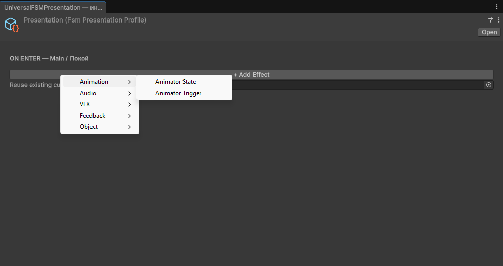
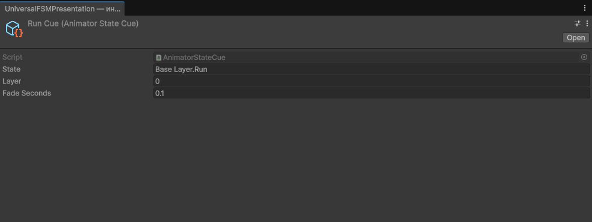

# Начало работы

## Установка обоих пакетов

Используйте Unity 6000.5 или новее. Git должен быть доступен процессу Unity. В **Window > Package Management > Package Manager** сначала установите UniversalFSM, затем Presentation по Git URL из [README](../README.md). Другой вариант — добавить следующие записи в `Packages/manifest.json`, сохранив остальные зависимости:

```json
{
  "dependencies": {
    "com.obliviomentis.universalfsm": "https://github.com/Oblivio-Mentis/Unity-UniversalFSM-Public.git#v0.2.0",
    "com.obliviomentis.presentation": "https://github.com/Oblivio-Mentis/Unity-UniversalFSMPresentation-Public.git#v0.3.2"
  }
}
```

Добавьте созданный Unity файл `Packages/packages-lock.json` в систему контроля версий. Сборка игрового кода должна ссылаться на `OblivioMentis.Presentation.Runtime` и `OblivioMentis.UniversalFSM.Runtime`. Код редактора размещайте в отдельной сборке с выбранной платформой **Editor**.

## Запуск примера

Выберите Presentation в Package Manager и импортируйте **UniversalFSMPresentation — базовый пример**. Выполните **Tools > Примеры Presentation > Создать демонстрационную сцену**. Генератор предложит сохранить изменённые сцены, откроет новую изолированную сцену и создаст независимые ассеты в уникальной папке `Assets/PresentationValidation` с числовым суффиксом при необходимости. Отмена диалога сохранения оставляет текущий набор сцен без изменений.

Запустите Play Mode. **Бег** воспроизводит анимацию, звук и частицы; **Прыжок** создаёт остаточный силуэт; **Атака** показывает оружие, запускает переход Animator по триггеру и создаёт импульс камеры. **Урон** публикует событие вспышки, силуэта и остановки времени с длительностью из данных события. Персонаж представлен геометрической фигурой, поэтому сторонняя графика не нужна. См. [подробный разбор](PracticalExamples.md).

## Первый эффект

1. Подготовьте работающее определение UniversalFSM и доменный профиль. Добавьте `UniversalFsmRuntimeController` на персонажа, назначьте оба ассета и проверьте инициализацию FSM.
2. Создайте **Assets > Create > FSM > Presentation > Profile** в папке проекта `Assets`. Назначьте то же определение FSM, которое использует контроллер.
3. В инспекторе профиля выберите слой и состояние покоя. В разделе **ON ENTER** нажмите **+ Add Effect > Animation > Animator State**.
4. Укажите в **State** полный путь состояния Animator, например `Base Layer.Idle`; задайте **Layer** = `0` и **Fade Seconds** = `0.1`. Здесь используется индекс слоя Animator, независимый от слоя FSM.
5. Добавьте Animator, назначьте Animator Controller и создайте в нём указанное состояние с анимационным клипом.
6. Через Add Component добавьте **FSM > Presentation > Driver**. Назначьте **Controller**, **Profile** и **Animator**, затем нажмите **Auto Assign Local Components** и **Validate Setup**. Устраните выданные предупреждения.
7. Запустите Play Mode. Драйвер выполняет привязку в `Start`, после инициализации контроллера, и один раз применяет эффекты входа текущего состояния. Измените состояние FSM, чтобы увидеть дальнейшие эффекты.

Встроенное меню создаёт отдельные ассеты рядом с профилем, в папке `<ProfileName> Cues`. Один ассет эффекта можно использовать в нескольких профилях; его изменение влияет на все ссылки.



*Для описанного первого эффекта выберите Animation > Animator State.*



*Эффект бега задаёт полный путь состояния Animator, индекс слоя и длительность плавного перехода в секундах.*

## Второй эффект

Добавьте **VFX > Sprite Flash** в список ON ENTER выбранного состояния. На персонажа добавьте `PresentationSpriteFlash` и заполните **Renderers** нужными SpriteRenderer. Назначьте этот компонент в поле **Sprite Flash** драйвера. Эффект изменяет цвет спрайта; для вспышки произвольного меша через шейдер нужен отдельный адаптер.

Вспомогательные компоненты требуются только используемым эффектам. Например, профиль только с анимацией не требует пулов или источника звука. Все зависимости перечислены в [справочнике компонентов](AssetsAndComponents.md).

## Получение игровых событий

Драйвер с назначенным контроллером автоматически наблюдает за состояниями. Шина доменных событий подключается явно: создайте `UniversalFsmSignalBus` в игровом коде и после инициализации контроллера вызовите `driver.Bind((IUniversalFsmStateChangeSource)controller.Runtime, bus)`. В профиле добавьте **DOMAIN EVENTS > + Add Domain Event** и задайте точный ключ, например `Damage`. [Код примера](../Samples~/BasicPresentation/BasicPresentationDemo.cs) показывает привязку, публикацию и повторное включение.

Далее: [настройка и порядок исполнения](AuthoringWorkflow.md).

