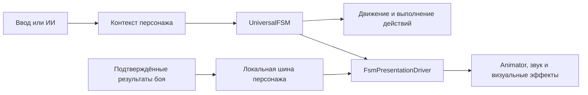

# Интеграция с игровыми системами

UniversalFSMPresentation наблюдает за существующей FSM и необязательной шиной событий предметной области. Пакет не инициализирует FSM, не продвигает игровое время, не рассчитывает урон и не выполняет движение. [Базовый пример Presentation](../Samples~/BasicPresentation/README.md) содержит самостоятельную рабочую сцену; раздел [«Практические примеры»](PracticalExamples.md) разбирает состояния Idle, Run, Jump и Attack.

## Состав персонажа



Размещайте игровые компоненты на корневом объекте персонажа, а анимируемую графику — на дочернем. Отдельный AudioSource позволяет при сбросе драйвера остановить его звуки, не затрагивая остальные. Назначьте пулы частиц, точки привязки, эффекты спрайтов и получатель импульса камеры в соответствии с эффектами профиля. Если несколько персонажей могут запрашивать глобальную остановку времени при ударе, используйте один общий `PresentationHitStop`, принадлежащий сцене.

Профиль Presentation должен ссылаться на определение, из которого собрана наблюдаемая FSM. Свойство `UniversalFsmRuntimeController.RuntimeDefinitionAsset` сохраняет этот источник сборки; `DefinitionAsset` — текущее поле настройки контроллера. Изменение последнего не меняет идентичность уже работающей FSM.

## Автоматическая привязка контроллера

Если нужны только события состояний, назначьте `driver.controller` и `driver.profile` до активации. Драйвер привязывается в Start и повторяет привязку при последующих включениях. Исполняемая FSM уже должна существовать и предоставлять `IUniversalFsmStateChangeSource`. Автоматическая привязка проверяет соответствие профиля и определения. Отсутствующую FSM драйвер самостоятельно не создаёт и не инициализирует.

## Явная привязка с событиями предметной области

Используйте явную привязку, если персонаж владеет шиной событий или инициализируется с задержкой. Оставьте поле Controller драйвера пустым до Start, чтобы привязкой управлял один компонент. Сначала назначьте профиль и ресурсы эффектов, включите драйвер и инициализируйте FSM через владельца игровой симуляции.

Следующий вспомогательный класс использует только публичный API пакетов. Вызывайте `BindAfterInitialization` один раз при настройке или повторном включении владельца, а не каждый кадр. При замене FSM или профиля явно отмените привязку, измените настройки и привяжите заново.

```csharp
using System;
using OblivioMentis.Presentation;
using OblivioMentis.UniversalFSM;

public static class ActorPresentationSetup
{
    public static void BindAfterInitialization(
        FsmPresentationDriver driver,
        UniversalFsmRuntimeController controller,
        IUniversalFsmSignalBus signals)
    {
        if (driver == null || controller == null || signals == null)
            throw new ArgumentNullException("Нужны локальные драйвер, контроллер и шина.");
        if (!driver.isActiveAndEnabled)
            throw new InvalidOperationException("Включите драйвер перед привязкой.");
        if (controller.Runtime == null || !controller.Runtime.IsInitialized)
            throw new InvalidOperationException("Сначала инициализируйте игровую FSM.");
        if (driver.profile == null ||
            driver.profile.definition != controller.RuntimeDefinitionAsset)
            throw new InvalidOperationException("Профиль должен соответствовать собранному определению FSM.");
        if (controller.Runtime is not IUniversalFsmStateChangeSource source)
            throw new InvalidOperationException("FSM должна предоставлять события смены состояний.");

        driver.controller = null;
        driver.Bind(source, signals);
    }
}
```

`Bind` сначала отменяет прежнюю привязку и очищает временные ресурсы. Через `IUniversalFsmCurrentLayerStateSource` он может повторить эффекты StateEnter для уже активных слоёв. Поэтому повторная привязка перезапускает эффекты и не подходит для проверки работоспособности каждый кадр. В этой версии нет публичного метода проверки текущей привязки. Назначьте одного владельца интеграции и явно обрабатывайте его жизненный цикл.

## Передача подтверждённых игровых событий

Создайте отдельный `UniversalFsmSignalBus` для каждого персонажа и передайте тот же экземпляр в `Bind`. Привязки предметной области получают только сигналы DomainEvent. Ключи сравниваются как точные строки: их смысл задаёт ваше приложение, готового протокола боя пакет не навязывает.

Например, после принятия попадания системой урона можно отправлять `combat.hit.confirmed`, а для единственного источника глобального отклика — `combat.hit_stop`. Не отправляйте остановку времени от обоих участников одного попадания, если два запроса не являются намеренной частью поведения.

```csharp
using OblivioMentis.UniversalFSM;
using UnityEngine;

public static class AcceptedImpactFeedback
{
    public static void Publish(
        UniversalFsmSignalBus actorSignals,
        long contactId,
        Vector2 position,
        Vector2 direction,
        float feedbackDuration)
    {
        var payload = new UniversalFsmDomainPayload(
            identity: contactId,
            duration: feedbackDuration,
            position: position,
            direction: direction);

        actorSignals.Publish(UniversalFsmSignal.Domain(
            "combat.hit.confirmed", domainPayload: payload));
        actorSignals.Publish(UniversalFsmSignal.Domain(
            "combat.hit_stop", domainPayload: payload));
    }
}
```

Вызывайте этот метод в основном потоке только после принятия игрового результата. Предполагается, что вызывающая сторона отвечает за оба события и передаёт конечную неотрицательную длительность. Исключайте повторные контакты в боевой системе. Поля `Identity`, идентификаторы, флаги и строки `UniversalFsmDomainPayload` переносят игровые данные; сами по себе они не реализуют урон, сетевое взаимодействие или исключение повторных событий.

Источник удара может отправить подтверждение в собственную шину, а отдельный адаптер цели — событие получения урона в шину цели. Так одновременно существующие персонажи не реагируют на чужие события.

## Остановка времени при ударе

Для постоянной длительности выберите `HitStopDurationSource.Authored` и задайте длительность в эффекте. Для индивидуального времени каждого попадания выберите `SignalPayload`: эффект читает `signal.DomainPayload.Duration`, применяет `payloadDurationMultiplier` и ограничивает результат заданными минимумом и максимумом. Значения должны быть конечными и неотрицательными, минимум — не больше максимума. Нулевая итоговая длительность не создаёт запрос.

Если данные не переданы, длительность равна нулю. Выбор SignalPayload сам по себе не получает время атаки из боевой системы. Передайте длительность явно или оставьте режим Authored. Координатор сцены объединяет запросы, отслеживает их завершение и отмену для каждого драйвера. Не запускайте в персонаже вторую корутину восстановления масштаба времени.

Игровая симуляция сама выбирает зависимые и независимые от масштаба времени часы. Остановка времени в Presentation не требует дополнительного Tick FSM. Сохраняйте единственного владельца симуляции и тогда, когда эффекты вызываются синхронно из событий состояния или предметной области.

## Анимация следует игровому состоянию

Свяжите события StateEnter состояний Idle/Run/Jump/Attack с эффектами Animator State или Animator Trigger. Сверьте контроллер Animator, путь и хеш состояния, слой и тип параметра со справочником эффектов. Косметическое смещение, вспышки и следы спрайта размещайте на дочерних визуальных объектах. Отключите root motion, если ваша система движения не получает его явно через единственный путь управления движением.

Переходы отражают игровое состояние. Завершение анимации должно менять данные игрового контекста только тогда, когда механика намеренно зависит от этого завершения. Presentation не должен самостоятельно выбирать атаки или наносить урон. Для одновременного движения и атаки используйте слои и маски Animator и отдельные слои FSM; это разные системы слоёв с разными идентификаторами и назначением.

## Противники и AgentAI

Враг может выбирать намерение по расстоянию или через отдельный пакет AgentAI. После этого он сохраняет данные и точки назначения, вызывает UniversalFSM и выполняет навигацию и бой через игровой контроллер. Presentation наблюдает получившиеся переходы и принятые боевые события так же, как у игрока.

Оценка решений AgentAI, правила восприятия, патруль, навигация, выполнение атак и пул объектов находятся вне этого пакета. Для отображения не нужна ссылка на AgentAI, а эффекты не должны пересчитывать решения ИИ. Перед повторным использованием графики сброс или отмена должны завершить активное действие противника в игровой системе.

## Сброс, отключение и пул объектов

`ResetPresentation()` останавливает отслеживаемые ресурсы эффектов, не изменяя игровую FSM. `Unbind()` удаляет подписки на источник и шину и очищает отображение. При отключении драйвера Unbind вызывается автоматически. После включения автоматическая привязка работает только при назначенном Controller; при явном управлении владелец должен привязать драйвер заново.

Для полного повторного использования персонажа соблюдайте такой порядок:

1. Остановите игровое обновление и сделайте старые асинхронные вызовы недействительными.
2. Отмените боевые действия и вызовите `driver.Unbind()` при смене игрового сеанса персонажа.
3. Сбросьте движение, здоровье, буферы ввода, данные контекста и ссылки на цели.
4. Один раз сбросьте существующую FSM через `controller.ResetRuntime()` или создайте и инициализируйте замену через владельца игровой симуляции.
5. Назначьте соответствующие профиль и ресурсы, затем привяжите активный драйвер к новому источнику и шине.
6. Возобновите игровое обновление.

Если при обычном сбросе сохраняются те же подписки, вызовите `ResetPresentation()` перед `ResetRuntime()`, чтобы удалить прежние эффекты. События сброса FSM затем запустят эффекты нового состояния. Не очищайте их повторно после этих событий, если подавление эффектов не задумано специально.

Ассеты профиля и эффектов можно использовать совместно. Собственный эффект должен хранить изменяемое состояние на ресурсе, принадлежащем драйверу, либо различать данные по драйверу и удалять их в Stop. Подробнее — [«Собственные эффекты»](CustomCues.md). Для пулов частиц и координатора остановки времени также необходимо явное владение: очистка одного персонажа не должна удалять ресурсы другого.

## Проверка интеграции

- Подключитесь к уже активной FSM и проверьте начальные эффекты входа.
- Отключите и включите персонажа: одно событие должно вызывать один эффект.
- Выполните сброс во время звука, вспышки, частиц и остановки времени; проверьте очистку и восстановление времени.
- Подключите двух персонажей с общим профилем к разным шинам и проверьте изоляцию событий.
- Намеренно замените определение или профиль и проверьте контроль конфигурации перед привязкой.
- Уничтожьте или верните в пул персонажа при наличии отложенных боевых вызовов; игровая реализация должна отклонить устаревшие вызовы.