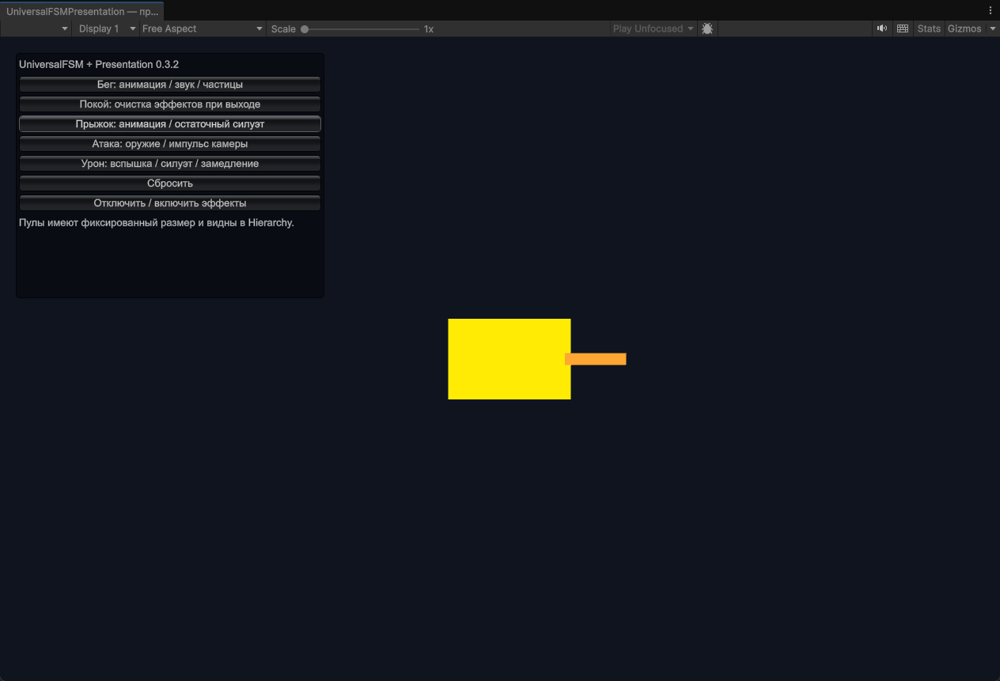

# Практические примеры

[Базовый пример](../Samples~/BasicPresentation/README.md) демонстрирует независимого персонажа с состояниями «Покой», «Бег», «Прыжок» и «Атака». Импортируйте его из Package Manager и выполните **Tools > Примеры Presentation > Создать демонстрационную сцену**. Генератор создаёт реальные ассеты и ссылки сцены, поэтому каждую привязку можно изучить и изменить.

*Созданный персонаж в атаке: видны оружие и пользовательский оттенок. Кнопки проверяют смену состояний, доменные события, очистку и повторную привязку.*

## Что создаёт генератор

| Ассет или компонент | Назначение |
|---|---|
| `FSM.asset` | Слой с ключом Main и состояниями: 1 — Покой, 2 — Бег, 3 — Прыжок, 4 — Атака |
| `Domain.asset` | Доменный профиль создаёт контекст и экземпляры четырёх состояний |
| `Presentation.asset` | Эффекты входа, выхода и доменного события Damage |
| `Actor.controller` и четыре клипа | Базовая анимация покоя, циклическое сжатие при беге, одноразовый прыжок и растяжение при атаке |
| `Square.png` | Созданный геометрический спрайт без сторонней графики |
| `Tone.wav` | Созданный короткий затухающий тон |
| `Particles.prefab` и материал | Незацикленный эффект с пулом из четырёх экземпляров |
| Персонаж, дочернее оружие и реестр | Точная точка `weapon` для переключения видимости |
| Компоненты отклика | Вспышка, остаточный силуэт и общий координатор времени |
| Камера и BasicCameraImpulse | Реализация интерфейса адаптера камеры |
| BasicPresentationDemo | Кнопки и собственная шина событий персонажа |

Исходники находятся в импортируемом примере, отдельно от Runtime пакета. Все создаваемые ассеты размещаются в уникальной папке. После предложения сохранить изменённые сцены генератор открывает изолированную сцену без конкурирующих камер и AudioListener. Отмена диалога сохраняет текущий набор сцен. Пакетный запуск не показывает диалоги и предназначен только для отдельного проверочного проекта.

## Покой и бег

1. Выберите созданный профиль Presentation и состояние **Main / Покой**.
2. В ON ENTER находятся AnimatorStateCue с путём `Base Layer.Idle` и эффект скрытия `weapon`. Это задаёт начальное визуальное состояние.
3. Выберите бег. Его список входа содержит AnimatorStateCue, AudioCue и ParticleCue именно в таком порядке.
4. ParticleCue ссылается на созданный префаб и включает **Stop On State Exit**. У персонажа есть соответствующий заранее подготовленный пул.
5. В Play Mode нажмите **Бег**, затем **Покой**. При входе выполняются эффекты бега; при выходе его частицы освобождаются до применения эффектов покоя.

Кнопки вызывают `TryForceTransition("Main", id)`, чтобы отдельно показать работу Presentation. Этот пример не реализует движение, ИИ или условия ввода. Переходы от игровых данных показаны в [примерах UniversalFSM](https://github.com/Oblivio-Mentis/Unity-UniversalFSM-Public/tree/main/Samples~).

## Прыжок

Вход в прыжок переключает Animator на `Base Layer.Jump` и создаёт один остаточный силуэт. Клип перемещает квадрат вверх и обратно. Силуэт сохраняет зафиксированную мировую позицию, пока исходный спрайт движется.

FSM остаётся в прыжке после окончания клипа, пока другая кнопка не изменит состояние. В реальном контроллере переход при приземлении должен определяться данными движения о контакте с землёй; одного завершения анимации недостаточно. Если действие действительно зависит от кадра анимации, передайте AnimationEvent обработчику игрового кода, который сообщит нужный факт или опубликует событие.

## Атака и оружие

При входе в атаку действия выполняются последовательно:

1. Устанавливается триггер Animator `Attack`. Переход Any State → Attack обрабатывает его с фиксированной длительностью смешивания 0,05 секунды.
2. Включается группа Renderer точки `weapon`.
3. Запрашивается импульс камеры.
4. Выполняется пользовательский эффект оттенка.

При выходе оружие скрывается, а ожидающий триггер сбрасывается. Атака наглядно запускается триггером; покой, бег и прыжок демонстрируют прямые эффекты состояния Animator. Созданный переход Any State не переходит сам в себя.

В рабочем графе Animator выбирайте прямой переход или триггер в соответствии с тем, кто управляет анимацией. Не создавайте два конкурирующих источника команд.

## Урон и подтверждённые результаты боя

Кнопка **Урон** публикует доменный сигнал с длительностью 0,12 секунды. Точная привязка `Damage` выполняет вспышку, снимок силуэта и HitStopCue в режиме **SignalPayload**. При множителе 1 и границах от 0 до 0,2 запрос действует 0,12 немасштабированной секунды.

Событие работает в любом состоянии, поскольку доменные ключи не используют селекторы состояния и слоя. Для настоящего урона применяйте ту же границу: публикуйте отклик после того, как Combat подтвердит результат. Разделяйте звук начала атаки и звук попадания — промах не должен выглядеть как нанесение урона.

Если персонажей несколько, каждому владельцу Presentation передавайте предназначенный ему поток событий, чтобы одно попадание не воспроизводилось у всех слушателей. [Интеграционное руководство](Integration.md) подробнее разбирает игрока, врагов и бой.

## Сброс и повторное включение

Нажмите **Сбросить**. Пример очищает временные эффекты, скрывает оружие, сбрасывает триггер Attack и отменяет смещение камеры, затем сбрасывает контроллер. **Отключить / включить эффекты** отменяет и восстанавливает ручные подписки на состояния и шину. Прямое переключение драйвера в инспекторе обнаруживается при ближайшей проверке активности в LateUpdate. Повторное исполнение входа текущего состояния при привязке ожидаемо. Очистка постоянных визуальных изменений — правило примера, отдельное от общей очистки пакета.

## Адаптация примера

- Замените созданные клипы, звук и частицы ассетами, на использование и распространение которых у вас есть права.
- Связывайте профиль с настоящим определением персонажа. Общие ассеты эффектов допустимы, идентификаторы из несвязанного определения — нет.
- Сопоставляйте префабы пулов по ссылке на объект и задавайте вместимость до инициализации.
- Замените BasicCameraImpulse адаптером своей системы камеры.
- Для возможностей вне девяти встроенных типов используйте [пример собственного эффекта](CustomCues.md).
- Проверьте все эффекты и сбросы в своей сцене: статическая проверка ссылок не подтверждает отрисовку, звук или поведение игры.

[Оглавление](index.md)

