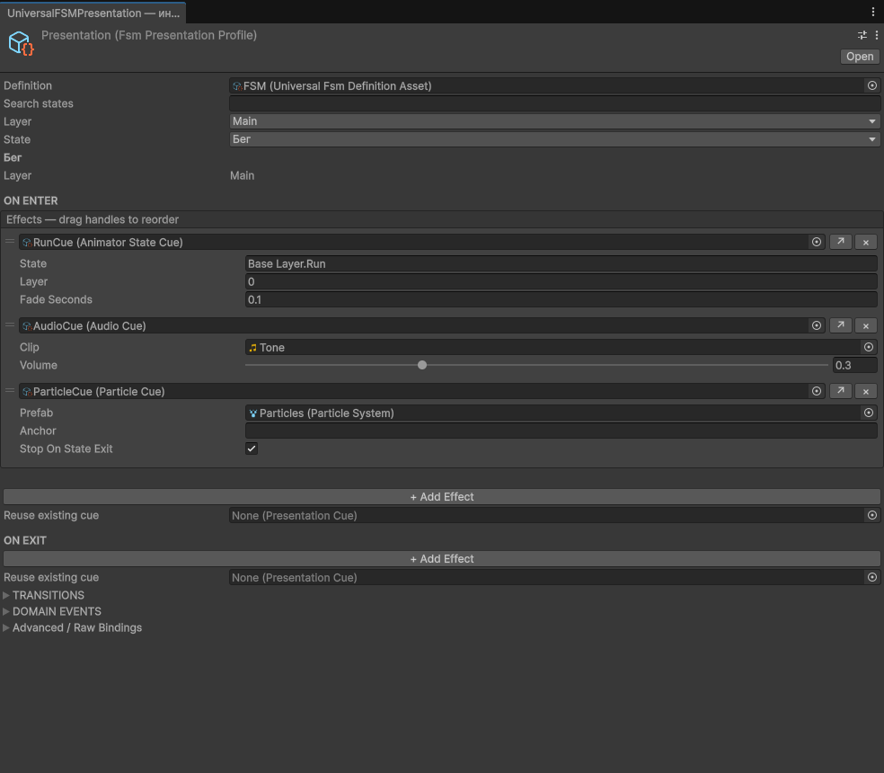
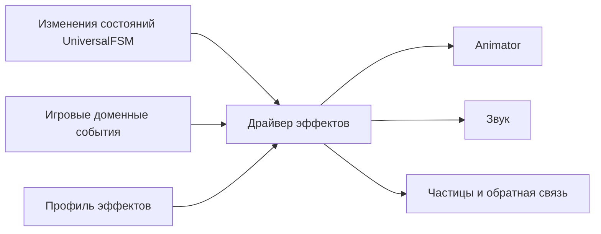
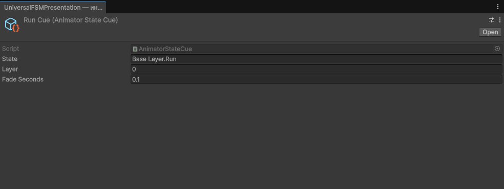
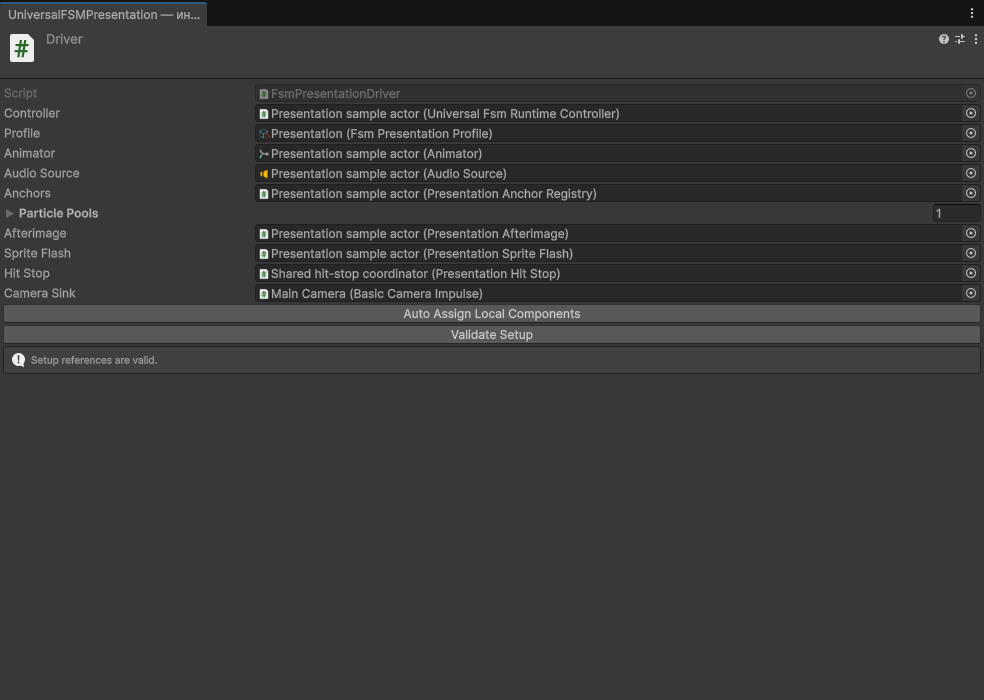
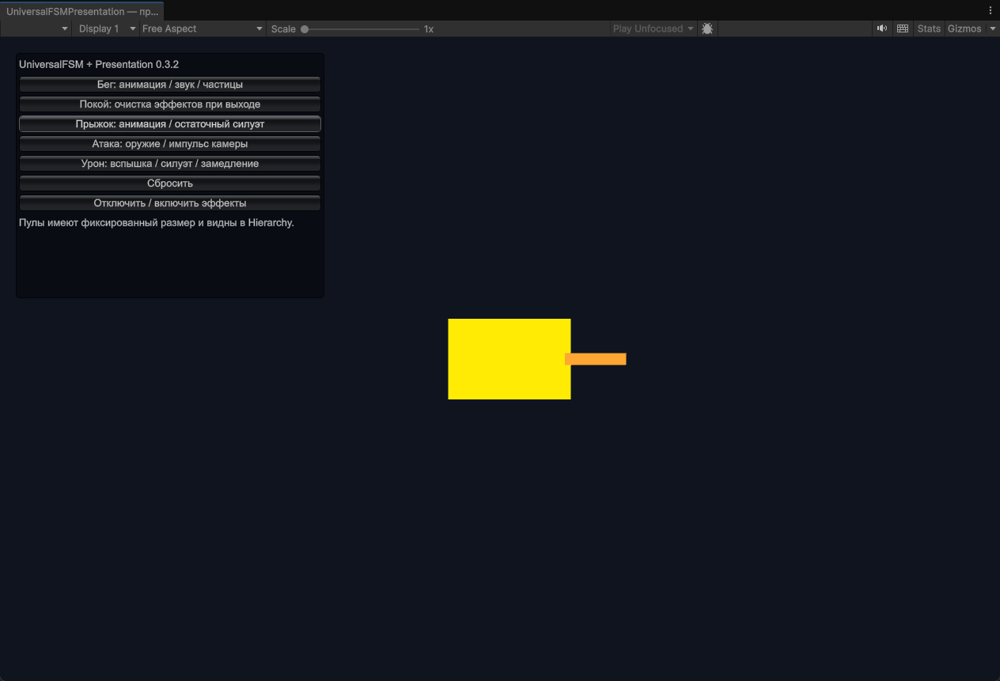

<div align="center">

# UniversalFSMPresentation

**У каждого состояния — свой визуальный и звуковой отклик.**

Анимация, звук, частицы и обратная связь для [UniversalFSM](https://github.com/Oblivio-Mentis/Unity-UniversalFSM-Public), настраиваемые через переиспользуемые ассеты Unity.


[](LICENSE.md)

[Начало работы](Documentation~/GettingStarted.md) · [Справочник эффектов](Documentation~/CueReference.md) · [Документация](Documentation~/index.md) · [Пример](Samples~/BasicPresentation/README.md)

</div>



*Настраивайте анимацию, звук и частицы вместе — в списке эффектов входа выбранного состояния.*

## Возможности

| Возможность | Применение |
|---|---|
| Девять встроенных типов эффектов | Состояния и триггеры Animator, однократное воспроизведение звука и частиц, вспышка спрайта, остаточный силуэт, остановка времени, импульс камеры и переключение объектов |
| Точные привязки к состояниям и переходам | Собственные эффекты для каждого слоя FSM без визуальной логики внутри игровых состояний |
| Доменные события и данные события | Отклик на урон и другие результаты игровых действий независимо от текущего состояния |
| Переиспользуемые ассеты эффектов | Один звук или эффект для нескольких состояний и персонажей с общей настройкой |
| Явное владение ресурсами | Заранее подготовленные пулы, компоненты отклика персонажа, общий координатор остановки времени и очистка при сбросе |
| Собственные эффекты и адаптеры камеры | Подключение специфичных для игры возможностей через небольшой C# API |



Драйвер наблюдает за существующей FSM. Ввод, перемещение, боевые решения и время симуляции остаются под управлением игровых систем.

## Скриншоты

| Настройка анимации | Компоненты персонажа |
|---|---|
|  |  |

[Меню создания эффектов и порядок работы →](Documentation~/AuthoringWorkflow.md)



*Независимый пример в состоянии «Атака»: созданный персонаж, видимое оружие и собственный эффект оттенка. Скриншоты получены в Unity 6000.5.7f1; подробности — в [отчёте о проверке](Documentation~/Validation.md).*

## Установка

В Unity Package Manager выберите **Install package from git URL** и последовательно установите:

```text
https://github.com/Oblivio-Mentis/Unity-UniversalFSM-Public.git#v0.2.0
```

```text
https://github.com/Oblivio-Mentis/Unity-UniversalFSMPresentation-Public.git#v0.3.2
```

Оставьте обе Git-зависимости в манифесте проекта. Presentation объявляет зависимость от UniversalFSM `0.2.0`; явная установка UniversalFSM позволяет получить её без закрытого реестра пакетов. [Полный манифест и настройка сборок →](Documentation~/GettingStarted.md)

## Быстрый запуск

1. Установите оба пакета и импортируйте **UniversalFSMPresentation — базовый пример** из раздела **Samples** в Package Manager.
2. Выберите **Tools > Примеры Presentation > Создать демонстрационную сцену**. Созданная сцена станет активной.
3. Запустите Play Mode. Кнопки **Бег**, **Прыжок**, **Атака** и **Урон** демонстрируют привязки. **Покой** показывает очистку при выходе, а **Сбросить** возвращает FSM в начальное состояние.
4. Выйдите из Play Mode и выберите созданный профиль `Presentation`. Выберите **Main / Атака**, чтобы изучить его эффекты.
5. Для своего персонажа создайте профиль через **Assets > Create > FSM > Presentation > Profile**, назначьте определение FSM и добавьте эффект **Animator State**. Добавьте `FsmPresentationDriver`, укажите профиль, контроллер и Animator, затем нажмите **Validate Setup**.

Пример самостоятельно создаёт квадратный спрайт, звук, анимационные клипы и префаб частиц. В нём нет игровых ассетов или другого закрытого содержимого.

## Документация

| Руководство | Содержание |
|---|---|
| [Начало работы](Documentation~/GettingStarted.md) | Установка, ссылки на сборки и первый эффект |
| [Ассеты и компоненты](Documentation~/AssetsAndComponents.md) | Все настраиваемые поля, зависимости сцены и время жизни |
| [Справочник эффектов](Documentation~/CueReference.md) | Девять встроенных типов, параметры, требования и примеры |
| [Порядок работы](Documentation~/AuthoringWorkflow.md) | Инспектор, порядок исполнения, переходы, события, привязка и очистка |
| [Практические примеры](Documentation~/PracticalExamples.md) | Покой, бег, прыжок, атака, отклик на урон и события анимации |
| [Интеграция с игрой](Documentation~/Integration.md) | Границы систем игрока, противников, боя и эффектов |
| [Собственные эффекты](Documentation~/CustomCues.md) | Пользовательский эффект и адаптер камеры |
| [Справочник API](Documentation~/API.md) | Публичные типы и сигнатуры методов |
| [Решение проблем](Documentation~/Troubleshooting.md) | Ошибки настройки, миграция и ограничения |

## Требования и совместимость

- Заявленная минимальная версия Unity — **6000.5**. Фактически проверенные версии указаны в [отчёте](Documentation~/Validation.md).
- Требуется UniversalFSM **0.2.0**; пространство имён исполнения — `OblivioMentis.Presentation`.
- Основной пакет не зависит от Input System, Combat, AgentAI или Cinemachine.
- Генератор примера выбирает материалы для встроенного конвейера рендеринга или URP; для других конвейеров может потребоваться замена материалов.
- Все вызовы во время игры выполняются в главном потоке Unity. Настройте объекты до привязки; после изменения профиля или замены FSM выполните привязку заново.
- Профили Presentation **0.2.0** нужно создать заново для схемы 0.3.x.

## Лицензия и поддержка

Проект поддерживает **Oblivio Mentis**. Условия распространения — [лицензия MIT](LICENSE.md); [пояснение на русском](Documentation~/License.md). Ассеты примера создаются включённым в него кодом.

Сообщайте о воспроизводимых проблемах через [GitHub Issues](https://github.com/Oblivio-Mentis/Unity-UniversalFSMPresentation-Public/issues). Укажите версию Unity, версии пакетов и минимальную конфигурацию для воспроизведения.

